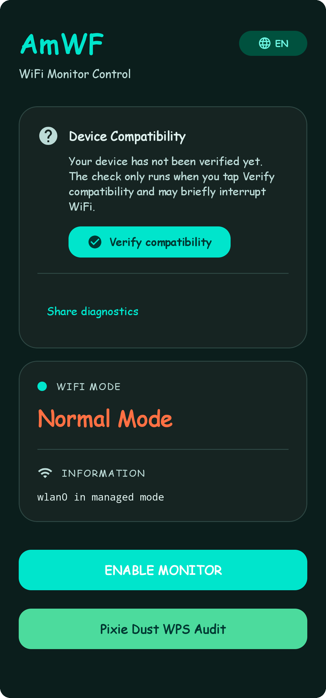

<div align="center">
  

  # AmWF

  **Your WiFi, under control.**

  Monitor mode and WPS Pixie Dust auditing from your Android phone, without a terminal or commands.

  [](https://github.com/Hitomatito/AmWF/releases)
  [](https://developer.android.com)
  [](#common-questions)
  [](LICENSE)
</div>

---

AmWF turns a rooted Qualcomm Snapdragon phone into a WiFi analysis tool. Enable monitor mode, verify what your hardware can do, and audit the WPS security of your own routers from a clean, one-handed interface.

No terminal. No scripts. No accounts.

> [!IMPORTANT]
> AmWF is a security research tool. Only audit networks you own or have explicit permission to test. See the [legal notice](DISCLAIMER_en.md) ([versión en español](DISCLAIMER_es.md)).

<div align="center">
  
</div>

> [!NOTE]
> Built for rooted Qualcomm Snapdragon devices running Android 7.0 or newer. Run **Verify compatibility** before enabling monitor mode.

---

## Documentation Index

Explore our comprehensive technical and user documentation:

| Document | Description |
|---|---|
| [📖 User Guide](docs/USER_GUIDE.md) | Step-by-step instructions for installation, permissions, monitor mode, Pixie Dust audits, and logs. |
| [🏗️ Architecture & Design](docs/ARCHITECTURE.md) | Technical deep dive into Qualcomm `con_mode`, custom `wpa_supplicant`, M1–M3 extraction, and software patterns. |
| [📱 Hardware Compatibility](docs/COMPATIBILITY.md) | Detailed SoC matrix (Snapdragon vs MediaTek/Exynos), Android 7–15 compatibility, and SELinux notes. |
| [🔧 Troubleshooting Guide](docs/TROUBLESHOOTING.md) | Diagnostic solutions for socket errors, missing binaries, association rejections, and WPS lockouts. |
| [⚙️ Building & Compiling](docs/BUILDING.md) | Gradle CLI commands, JDK 21 / SDK setup, unit testing, lint, and native NDK rebuilds. |
| [🤝 Contributing Guidelines](CONTRIBUTING.md) | Code architecture rules, Conventional Commits, testing requirements, and i18n conventions. |
| [📦 Native Binaries Setup](BINARIES_SETUP.md) | Provenance, patch recipes, and build details for bundled ARM native tools. |
| [🛡️ Security Policy](SECURITY.md) | Safe harbor, supported versions, and responsible vulnerability reporting. |

---

## Why AmWF?

A WiFi audit usually means a laptop, a supported adapter, a terminal, and a stack of scripts. AmWF moves that workflow to the phone in your pocket:

- **No terminal.** Every step has a clear button and a readable status.
- **No guesswork.** The compatibility check tells you what your hardware can do before you change anything.
- **No leftover state.** WiFi is restored automatically when an audit ends.
- **No accounts, no cloud.** The app has no Internet permission.

---

## What you can do

### Monitor mode, without the hassle

Turn your phone's WiFi adapter into an 802.11 capture sensor with a single tap.

- Enable and disable monitor mode whenever you want.
- Check your WiFi status, interface, and frequency at any time.
- Return to normal mode instantly, without repeating checks.

### Verification at your own pace

Before changing anything, AmWF can make sure your device is ready.

- Detects your chipset, driver, and root access.
- Checks capture, injection, and WiFi control with a progress bar.
- Nothing runs automatically: you decide when to verify.
- The result stays available for the session, so you never have to repeat the test.

### WPS Pixie Dust auditing

Find out whether your routers' WPS can resist a Pixie Dust attack.

- Scan nearby networks and see which ones have WPS available.
- Search by name or BSSID, and filter by auditable or dual-band networks.
- Tap a network and the audit starts immediately, with no extra forms or buttons.
- Recover the WPS PIN and, when possible, the WPA key.
- Copy the credentials to your clipboard with one tap.

### The whole process, in plain sight

- Phase-by-phase progress, percentage, and session timer.
- Collapsible console with the details of every step.
- Stop the audit whenever you want.

### Privacy by design

- AmWF has no Internet permission: nothing is sent to external servers.
- The exportable diagnostic report redacts MAC addresses and network names before sharing.
- Audit logs are stored locally with restricted permissions.

> [!WARNING]
> Audit logs may contain the WPS PIN and WPA key in plain text. Do not share them or upload them anywhere.

---

## Download & Installation

1. **Download APK:** Grab the latest release APK from [GitHub Releases](https://github.com/Hitomatito/AmWF/releases/latest).
2. **Install & Grant Root:** Install the APK on your Qualcomm device and grant Superuser access when prompted (Magisk, KernelSU, or APatch).
3. **Location Services:** Ensure system Location (GPS) is turned ON and runtime permissions (`Nearby devices` / `Fine Location`) are granted for Wi-Fi scanning.

---

## Quick Start

1. Open AmWF and tap **Verify compatibility** (**Verificar compatibilidad**).
2. Enable **Monitor Mode** whenever you want to analyze your surroundings.
3. Open **WPS Pixie Dust Audit**, pick a network, and let AmWF do the rest.

---

## Developer Quick Start

AmWF is a single-module Gradle project (`:app`).

```bash
# Run unit tests
./gradlew :app:testDebugUnitTest

# Run Android Lint
./gradlew :app:lintDebug

# Assemble Debug APK
./gradlew :app:assembleDebug
```

For detailed build instructions, signing options, and native binary compilation, see [docs/BUILDING.md](docs/BUILDING.md).

---

## Common Questions

**Do I need root?**  
Yes. Monitor mode and low-level WiFi control require root access (Magisk, KernelSU, or APatch). The guided check tells you whether your device is ready.

**Which devices are supported?**  
AmWF is built for Qualcomm Snapdragon devices. See the full [Hardware Compatibility Matrix](docs/COMPATIBILITY.md) for supported chipsets and technical details.

**Does it need an external WiFi adapter?**  
No. AmWF uses your phone's built-in Qualcomm WiFi adapter.

**Does it work on Android 13 and newer?**  
Yes. Scanning nearby networks requires precise location on every Android version, plus the Nearby Wi-Fi Devices permission on Android 13 and newer.

**Where does my data go?**  
Nowhere. AmWF has no Internet permission. Diagnostics and audit logs stay strictly on your device.

**Is it legal to audit any network?**  
No. Only audit networks you own or have explicit permission to test. See [DISCLAIMER_en.md](DISCLAIMER_en.md).

---

<div align="center">
  <sub>AmWF &copy; 2026 Hitomatito</sub><br>
  <sub>Free software under <a href="LICENSE">GPL-3.0</a> · <a href="THIRD-PARTY-NOTICES.md">Third-party notices</a> · <a href="DISCLAIMER_en.md">Legal notice</a> · <a href="SECURITY.md">Security policy</a> · <a href="https://github.com/Hitomatito/AmWF/issues">Report an issue</a></sub>
</div>
