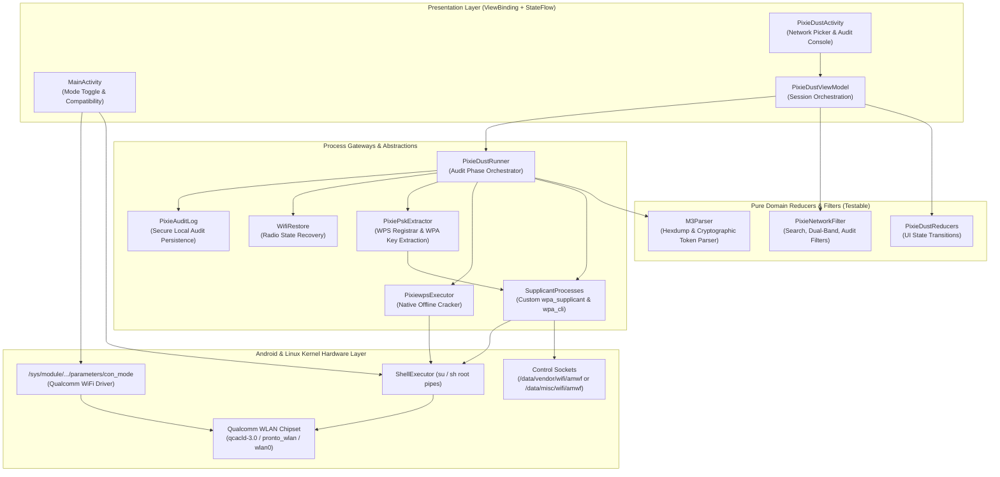
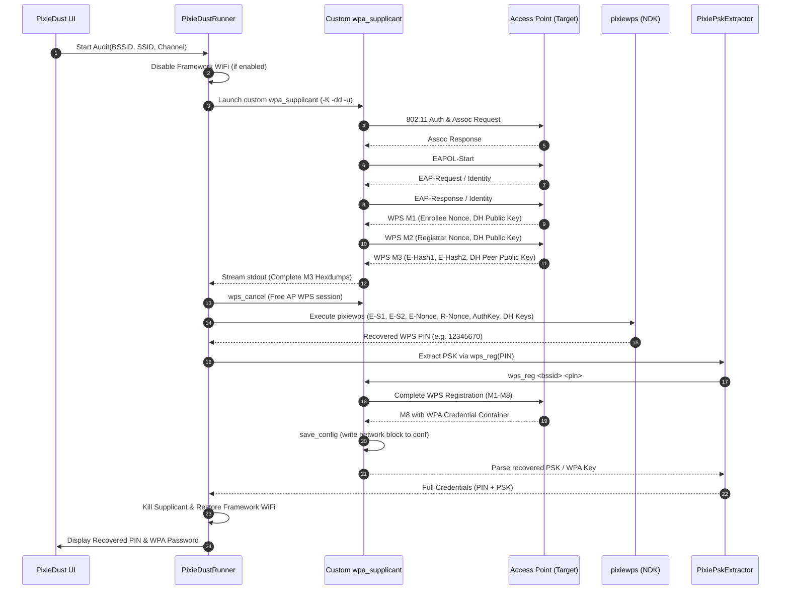

# AmWF Architecture & Technical Design

This document details the internal architecture, hardware interfaces, cryptographic pipelines, and software design of **AmWF**.

---

## 1. High-Level System Architecture

AmWF is designed as a single-module Android application (`:app`) built in Kotlin, targeting rooted Qualcomm Snapdragon devices running Android 7.0 (API 24) through Android 15+ (API 35+).

The following diagram illustrates how the presentation layer, domain reducers, native process gateways, and hardware interfaces interact:

---

## 2. Qualcomm `con_mode` Subsystem

### 2.1 What is `con_mode`?
Qualcomm Snapdragon Wi-Fi drivers (such as `qcacld-3.0`, `qcacld-2.0`, `pronto_wlan`, or unified `wlan.ko`) expose an operational mode parameter in the Linux `sysfs` filesystem named `con_mode`.

| Mode Value | Description |
|:---:|---|
| `con_mode=0` | **STA (Station) / Infrastructure Mode** — Standard Wi-Fi client mode used by Android framework. |
| `con_mode=4` | **Monitor Mode (RFMON)** — Puts the physical baseband and MAC into promiscuous raw 802.11 capture mode. |

### 2.2 Dynamic Path Discovery & SELinux Restrictions
The location of the `con_mode` parameter varies across different device trees, Android versions, and Qualcomm BSP releases:
- `/sys/module/wlan/parameters/con_mode`
- `/sys/module/qcacld_3_0/parameters/con_mode`
- `/sys/module/qcacld30/parameters/con_mode`
- `/sys/module/qcacld_2_0/parameters/con_mode`
- `/sys/module/pronto_wlan/parameters/con_mode`

> [!IMPORTANT]
> **SELinux Isolation:** Android UID sandboxing frequently blocks standard application processes from reading directory contents under `/sys/module`. Therefore, `resolveConModePath()` performs path discovery via privileged root commands (`su -c "find ..."`) rather than plain `java.io.File` scans, preventing false-negative compatibility results on modern devices.

### 2.3 Mode Switching Sequence
Switching between Station mode and Monitor mode requires coordinated radio cycling to avoid kernel panics or driver deadlocks:
1. Turn off Android framework Wi-Fi subsystem (`svc wifi disable`).
2. Write mode flag to sysfs via root: `echo <mode> > /sys/module/.../parameters/con_mode`.
3. Bring the interface down and up or cycle kernel module state as required.
4. Verify link status and mode with `iw dev <iface> info`.

---

## 3. WPS Pixie Dust Attack Pipeline

The Pixie Dust attack (discovered by Dominique Bongard in 2014) targets vulnerabilities in the pseudo-random number generator (PRNG) implementations of access points using WPS (Wi-Fi Protected Setup). When an AP generates nonces non-cryptographically (e.g., using predictable seeds or zeroed nonces), an attacker can compute the WPS PIN offline in seconds without brute-forcing the router over the air.

### 3.1 Why Android's Stock `wpa_supplicant` Cannot Be Used
Standard Android distributions compile `wpa_supplicant` with `CONFIG_ANDROID_LOG`. Under this build flag:
- All debug hexdumps are redirected to Android's logcat.
- **Dumps are truncated to 32 bytes.**
- The Diffie-Hellman public key exchange requires **192 bytes** (384 hexadecimal characters) to reconstruct the shared secret. With a 32-byte truncated key, offline cryptographic calculation is mathematically impossible.

### 3.2 AmWF's Custom Native Toolchain
AmWF ships prebuilt ARM binaries in `app/src/main/assets/wifi/`:
- **`wpa_supplicant` (arm64-v8a):** Built from upstream `wpa_supplicant 2.11` without `CONFIG_ANDROID_LOG`, with `CONFIG_DEBUG_FILE=y`, linked against `libnl 3.2.25`.
- **Stdout Flush Patch:** `scripts/patches/wpa_supplicant-2.11-stdout-flush.patch` injects `fflush(stdout)` after debug line emission so `M3Parser` reads fields immediately via pipe streams instead of waiting for process exit.
- **`-K` Flag:** Preserves key material (including `AuthKey`) in stdout rather than printing `[REMOVED]`.
- **`pixiewps` (arm64-v8a & armeabi-v7a):** Compiled with Android NDK r27, supporting full offline attack modes.

### 3.3 Session Cleanup & "Unexpected State (15)" Mitigation
A critical operational bug in naive WPS audit tools occurs when killing the supplicant immediately upon capturing M3. If killed abruptly:
1. The target Access Point keeps its WPS registrar session open awaiting M4.
2. When AmWF attempts PSK extraction via `wps_reg` a few seconds later, the AP receives a new M1 while its internal state machine expects M4.
3. The AP rejects the exchange with **"Unexpected state (15)"**.

**Solution implemented in AmWF:** Immediately after M3 extraction succeeds, AmWF sends `wps_cancel` through `wpa_cli` to formally tear down the enrollment handshake before initiating the PSK retrieval session.

---

## 4. Software Architecture & Design Patterns

### 4.1 Unidirectional Data Flow & Pure Reducers
To ensure rock-solid stability and comprehensive JVM unit-testability:
- **No Android `Context` in Business Logic:** `PixieDustRunner`, `M3Parser`, `PixieProcessSupport`, and reducers operate strictly on pure inputs, streams, or gateway interfaces.
- **`PixieDustReducers.kt`:** Pure functions computing UI state changes, retry progression, and error categorizations.
- **`PixieNetworkFilter.kt`:** Pure filter pipeline for SSID search, auditable WPS detection, and dual-band classification.

### 4.2 Legacy Android Compatibility (`ProcessCompat.kt`)
Because AmWF supports devices starting at Android 7.0 (API 24, minSdk 24), Java 9 / Android API 26 process management methods (`Process.isAlive()`, `Process.destroyForcibly()`, `Process.waitFor(timeout, unit)`) are unavailable natively on API 24–25.
`ProcessCompat` provides safe polyfills using Linux signals (`SIGTERM` / `SIGKILL`) and non-blocking exit-code polls.

### 4.3 SELinux-Compliant Config Staging
Under SELinux Enforcing mode, the `su` domain cannot directly read private application directories (`/data/user/0/com.hitomatito.amwf/files`). AmWF circumvents this restriction cleanly by streaming configuration files directly into privileged memory pipes using `ShellExecutor.execRootWithInput()`, staging files directly into the WiFi control directory:
- Android 9.0+ (API 28+): `/data/vendor/wifi/amwf`
- Android 7.0–8.1 (API 24–27): `/data/misc/wifi/amwf`

### 4.4 Dynamic Runtime Localization (`LocaleHelper.kt`)
AmWF supports instant language switching between Spanish and English without relying on system-wide device language settings.
To prevent Android's default resource caching from ignoring the selected locale:
- Every `Activity` overrides `attachBaseContext` with `LocaleHelper.applyLocale()`.
- ViewModels and asynchronous gateways wrap contexts explicitly (`PixieDustRunner.create(context)`).
- Application bundle splits are explicitly disabled (`bundle { language { enableSplit = false } }`) in Gradle so bundled APKs retain all translations.

---

## 5. Security & Privacy Model

| Aspect | Architectural Enforcement |
|---|---|
| **Zero Network Telemetry** | No `android.permission.INTERNET` declared in `AndroidManifest.xml`. The app cannot communicate with external servers or cloud services. |
| **Diagnostics Redaction** | `DiagnosticsFormat` automatically truncates all MAC addresses to their OUI (vendor prefix) and redacts network SSIDs before sharing. |
| **Separation of Sensitive Logs** | `ShellExecutor` logs operational metrics to in-memory `AppLogger`. Conversely, `PixieDustRunner.log` bypasses `AppLogger` entirely using raw `Log.d` to ensure plain-text WPS PINs and WPA keys are never included in exported diagnostic dumps. |
| **Audit Log Storage** | Audit reports are saved strictly to local storage (`/sdcard/AmWF/pixie-logs/` with fallback to `context.filesDir/pixie-logs/`) with restricted permissions. |
